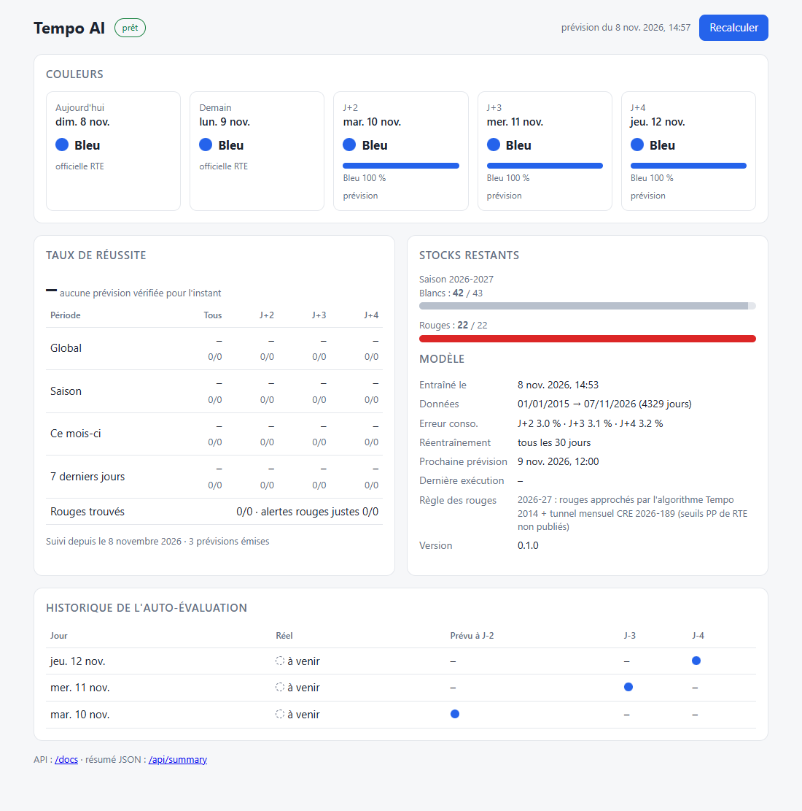
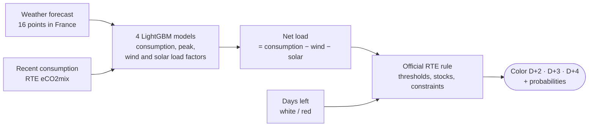

# Tempo AI

Local AI that forecasts the French **Tempo** electricity color (blue / white / red) **2 to 4 days
ahead**. RTE only publishes the next day. A LightGBM model predicts the national net load from
weather forecasts, then RTE's official rules turn it into a color. On the 2024-25 and 2025-26
winters it scored **85–88 %** accuracy, against 51–61 % for "same color as tomorrow".

It runs as a single container, for example a TrueNAS app. Every day it checks its own past
forecasts against the real colors, and it serves a REST API and a small web page.

> 🇫🇷 Une explication pas à pas en français, sans prérequis en IA :
> [train/COMPRENDRE.md](train/COMPRENDRE.md). Le détail du rejeu : [train/LISEZMOI.md](train/LISEZMOI.md).



## How it works



- **The AI part** only predicts megawatts. That is a physical, stable relationship learned from about
  4,300 days since 2015.
- **The rule part** follows the RTE documents as written:
  - the 2014 algorithm;
  - the remaining stocks;
  - the limit of 5 red days in a row, and red days only on weekdays from November to March;
  - the end-of-winter catch-up;
  - since 2026-27, the CRE monthly range for red days.
- **Probabilities** come from re-running the rule with the net load shifted by its typical forecast
  error (4–6 %).

### Limits

Since 1 November 2026, red days are the "PP" days of the capacity mechanism (CRE decision
2026-189). A day is red when the hourly residual peak exceeds a threshold table that RTE has not
published yet. Until it does, red days are approximated with the 2014 algorithm, kept within the
monthly range of the decision. White days still follow the 2014 algorithm.

## Run it

### Docker

```bash
docker run -d --name tempo-ai -p 31090:8080 -v tempo-ai-data:/data \
  -e TZ=Europe/Paris ghcr.io/lgm42/tempo-ai:0.1.0
```

Open `http://<host>:31090/`. On the first start the app needs about **10 minutes**: it downloads
the history (eCO2mix since 2015, ERA5 weather for 16 points) and trains its models. Training takes
under a minute on a CPU, and no GPU is needed. The data folder takes about 70 MB, and the container uses about 450 MB of RAM.

### TrueNAS

- **Before the app is in the catalog:** Apps → Discover → ⋮ → **Install via YAML**, with
  [truenas/custom-app.yaml](truenas/custom-app.yaml).
- **Catalog files:** [truenas/tempo-ai/](truenas/tempo-ai/) holds `app.yaml`, `ix_values.yaml`,
  `questions.yaml` and `templates/`, in the format of the
  [truenas/apps](https://github.com/truenas/apps) community train.

### Configuration

| Variable | Default | Meaning |
|---|---|---|
| `TEMPO_DATA_DIR` | `/data` | Persistent folder: raw data, models, SQLite database |
| `TEMPO_FORECAST_TIME` | `12:00` | Time of the daily forecast stored for self-evaluation (Europe/Paris). RTE publishes D+1 around 10:40. |
| `TEMPO_RETRAIN_DAYS` | `30` | Retrain when the last training is older than this (0 = never) |
| `TEMPO_API_TOKEN` | *(empty)* | If set, actions (`POST`, `?refresh=true`) need `Authorization: Bearer <token>` |
| `PORT` | `8080` | HTTP port inside the container |

## API

Interactive documentation: `/docs`.

| Endpoint | Content |
|---|---|
| `GET /api/summary` | **Everything in one request:** today, tomorrow, D+2/D+3/D+4 forecasts with probabilities, stocks, success rates (overall, season, month, last 7 days, per horizon, red days found), tracking start date, last training, next run |
| `GET /api/forecast` | Latest forecast; `?refresh=true` collects fresh data and recomputes now |
| `GET /api/stats` | Success rates only |
| `GET /api/history?days=30` | For each day: real color and the forecasts made 2, 3 and 4 days before |
| `GET /api/model` | Current model and training history |
| `GET /api/runs` | Task log |
| `GET /api/health` | Service status |
| `POST /api/run` | Run the daily forecast now |
| `POST /api/train` | Retrain now |

Excerpt of `/api/summary`:

```json
{
  "forecast": [
    {"date": "2026-11-10", "horizon": 2, "color": "blue",
     "probabilities": {"blue": 0.97, "white": 0.03, "red": 0.0},
     "net_load_mw": 48536, "score": 0.757, "threshold_white": 1.271, "threshold_red": 1.758}
  ],
  "accuracy": {
    "tracking_since": "2026-11-08",
    "overall": {"rate": 0.87, "correct": 26, "total": 30,
                "by_horizon": {"J+2": {"rate": 0.9, "correct": 9, "total": 10}}},
    "month": {}, "last_7_days": {}
  },
  "model": {"trained_at": "2026-11-08T14:53:56+01:00", "training_days": 4329}
}
```

### Home Assistant

The configuration below reads everything with a single REST call:

```yaml
rest:
  - resource: http://<host>:31090/api/summary
    scan_interval: 900
    sensor:
      - name: Tempo AI J+2
        value_template: "{{ value_json.forecast[0].color }}"
        json_attributes_path: "$.forecast[0]"
        json_attributes: [date, probabilities, score]
      - name: Tempo AI J+3
        value_template: "{{ value_json.forecast[1].color }}"
        json_attributes_path: "$.forecast[1]"
        json_attributes: [date, probabilities, score]
      - name: Tempo AI J+4
        value_template: "{{ value_json.forecast[2].color }}"
        json_attributes_path: "$.forecast[2]"
        json_attributes: [date, probabilities, score]
      - name: Tempo AI success rate
        value_template: "{{ ((value_json.accuracy.overall.rate or 0) * 100) | round(1) }}"
        unit_of_measurement: "%"
        json_attributes_path: "$.accuracy"
        json_attributes: [tracking_since, month, last_7_days]
```

## Repository layout

| Folder | Content |
|---|---|
| [soft/](soft/) | The application: `tempo_ai` package (collection, model, rules, forecast, SQLite, API, scheduler, web page) and `Dockerfile` |
| [train/](train/) | Research: replay of past winters (`backtest.py`), fidelity of the rule (`verif_regle.py`), forecast archives collection, results, French documentation |
| [truenas/](truenas/) | TrueNAS catalog files and the custom app YAML |

The research scripts import the same `tempo_ai` package as the app:

```bash
python -m venv .venv && .venv/bin/pip install -r soft/requirements.txt
cd train
python collecte_recherche.py   # history + archived forecasts (cache in train/data)
python backtest.py             # replay → resultats/rejeu.csv, resultats/scores.csv
```

Unit tests run without network or downloaded data: RTE rules, self-evaluation statistics, forecast
chaining and the API. CI runs them on every push, and the image is built only when they pass.

```bash
cd soft
pip install -r requirements-dev.txt
pytest
```

## Data and credits

- [RTE eCO2mix](https://odre.opendatasoft.com) (Etalab open licence)
- [Open-Meteo](https://open-meteo.com) weather data (CC BY 4.0)
- [api-couleur-tempo.fr](https://www.api-couleur-tempo.fr) for the official colors

The rules come from the RTE and CRE documents listed in [train/docs/SOURCES.md](train/docs/SOURCES.md).

This project is not affiliated with EDF or RTE. Forecasts are estimates: always check the official
color.
