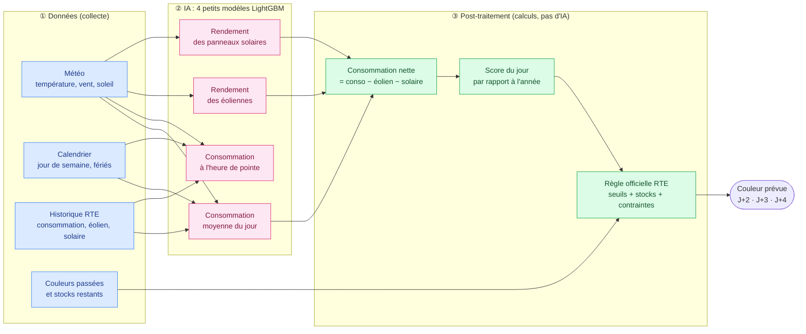
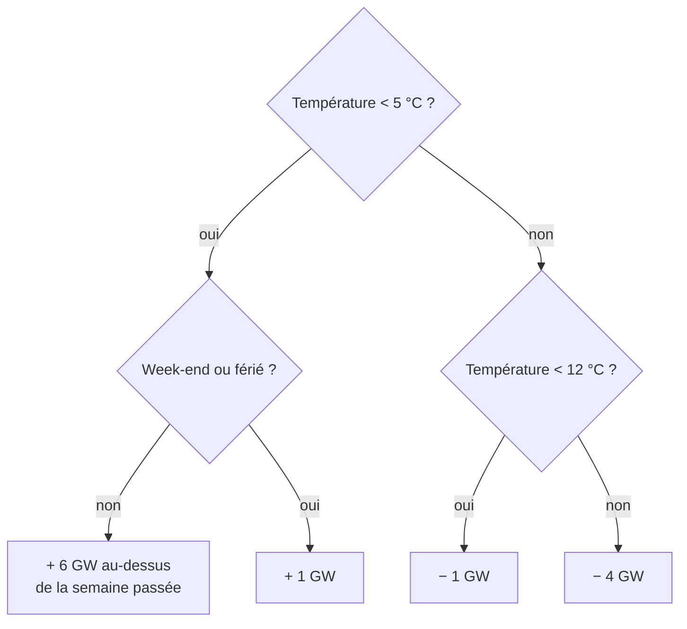
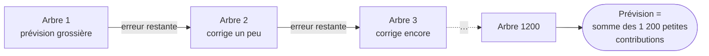
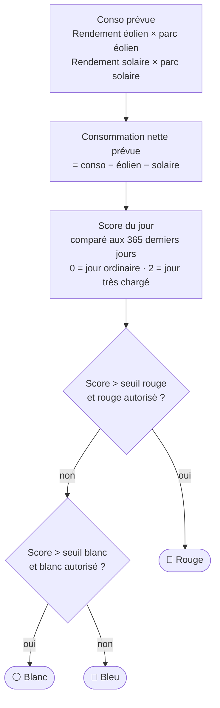
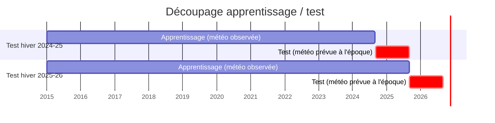
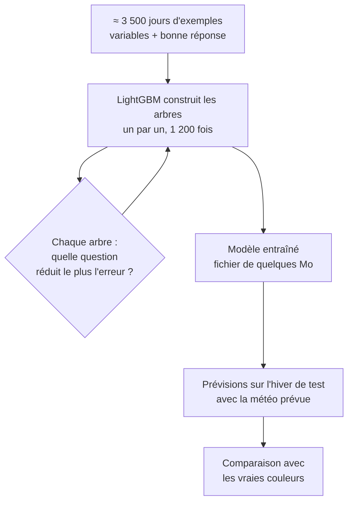
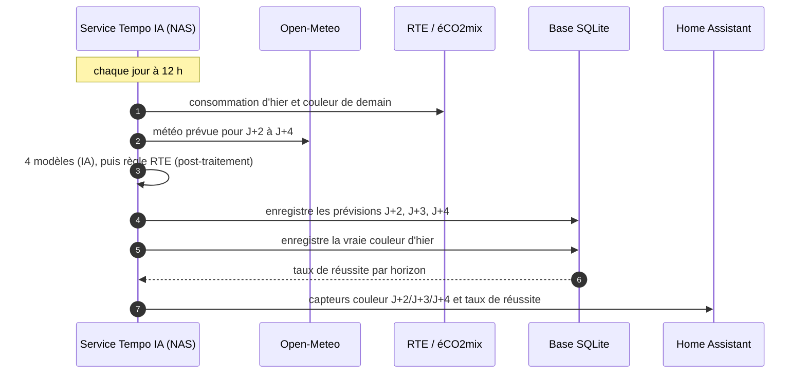

# Comprendre le projet Tempo IA, sans connaître l'IA

Ce document explique simplement ce que fait ce projet :
- les données utilisées ;
- la partie qui relève de l'IA, et ce qui n'est que du calcul classique ;
- comment se passe l'apprentissage ;
- comment lire les résultats.

Le détail technique est dans [LISEZMOI.md](LISEZMOI.md).

---

## 1. Le problème en une phrase

Chaque jour, on veut deviner la couleur Tempo (bleu, blanc ou rouge) d'après-demain (J+2), du
jour suivant (J+3) et du jour d'après (J+4). RTE, lui, ne publie que la couleur de demain (J+1),
à 10 h 30.

Ce n'est pas un tirage au hasard. RTE choisit les couleurs avec une **règle publique** : plus la
France consomme d'électricité que l'éolien et le solaire ne couvrent pas, plus le jour risque
d'être blanc ou rouge. La règle tient aussi compte du stock de jours blancs et rouges restants.

Deviner la couleur revient donc surtout à **deviner la consommation d'électricité** dans 2 à 4
jours. Elle dépend essentiellement de la **météo** : le froid fait chauffer, et le vent fait
tourner les éoliennes.

---

## 2. Vue d'ensemble

| Couleur | Étape | Rôle |
|---|---|---|
| 🔵 Bleu | **Données** | On rassemble et on met en forme : rien n'est « intelligent » ici. |
| 🌸 Rose | **IA** | La seule partie apprise. Elle prévoit des **mégawatts**, pas des couleurs. |
| 🟢 Vert | **Post-traitement** | Des calculs fixes, écrits à la main d'après les documents officiels de RTE. |

> 💡 Point important : **l'IA ne voit jamais de couleur**. Elle répond à une question de physique,
> « combien la France va-t-elle consommer ? ». C'est la règle RTE, recopiée telle quelle, qui
> transforme ce chiffre en couleur.

---

## 3. Les données

### 3.1 D'où elles viennent

| Donnée | Source (gratuite) | Depuis | Pas de temps |
|---|---|---|---|
| Consommation France, production éolienne et solaire | RTE / éCO2mix, via le portail ODRÉ | 2015 | 15 min, ramené à l'heure |
| Couleurs Tempo passées | api-couleur-tempo.fr | 2019 | jour |
| Météo **réellement observée** | Open-Meteo, réanalyse ERA5 | 2015 | heure |
| Météo **telle qu'elle était prévue** 1 à 5 jours avant | Open-Meteo, « previous runs » | octobre 2024 | heure |
| Jours fériés | bibliothèque Python `holidays` | — | jour |

Tout est stocké dans un dossier de données au format **parquet**, un tableau compressé et rapide à relire.

### 3.2 La météo : 16 points en France

La météo n'est pas la même partout. On interroge donc **16 points** :
- **8 villes**, pondérées par leur population (Paris compte 13 fois plus que Strasbourg) : ce
  sont elles qui consomment ;
- **8 zones éoliennes** (Picardie, Champagne, Beauce, Bretagne, etc.) : c'est là que le vent compte.

Pour le vent, la vitesse brute ne suffit pas. Une éolienne ne produit rien sous 3 m/s, atteint
son plein régime vers 12 m/s et s'arrête par sécurité au-delà de 25 m/s. On convertit donc chaque
vitesse en **production théorique** avec cette « courbe de puissance » : c'est plus parlant pour
le modèle.

### 3.3 À quoi ressemble une ligne du tableau

Chaque **jour** devient **une ligne** d'environ 40 colonnes. Il y a environ 4 300 lignes depuis 2015.

| Jour | Temp. moyenne | Vent éolien | Jour de semaine | Férié | Conso (GW) | Éolien (GW) | Couleur |
|---|---|---|---|---|---|---|---|
| lun. 5 janv. 2026 | −1,9 °C | faible | lundi | non | 81,8 | 3,8 | 🔴 Rouge |
| ven. 9 janv. 2026 | +5,3 °C | fort | vendredi | non | 71,0 | 18,4 | 🔵 Bleu |

Ces deux jours sont à 4 jours d'écart. Le 9, il fait un peu plus doux, et surtout les éoliennes
produisent 5 fois plus. Le bleu remplace le rouge.

### 3.4 « Observé » ou « prévu » : une différence essentielle

- La **météo observée** est ce qui s'est réellement passé. Elle sert à **apprendre**.
- La **météo prévue** est ce que les prévisionnistes annonçaient 2, 3 ou 4 jours avant. C'est la
  seule disponible en conditions réelles : le jour où l'on prévoit J+4, on ne connaît pas encore
  la vraie météo de J+4.

Pour que le test soit honnête, on teste donc le modèle avec la météo **prévue à l'époque**,
erreurs des météorologues comprises. Ces archives n'existent que depuis octobre 2024 : c'est
pourquoi le test porte sur deux hivers seulement.

---

## 4. Pourquoi ne pas demander directement la couleur à l'IA ?

C'était l'idée la plus intuitive, mais elle marcherait mal :

1. **Trop peu d'exemples** : en 7 saisons, il n'y a eu que **150 jours rouges**. C'est très peu pour
   qu'une IA comprenne seule ce qui fait un rouge.
2. **La couleur dépend du passé** : un même froid donne un rouge en janvier s'il reste des rouges en
   stock, et un bleu s'ils sont épuisés. L'IA devrait réapprendre seule le comptage des stocks.
3. **Les règles changent** (c'est le cas depuis le 1er novembre 2026). Une IA entraînée sur
   l'ancienne règle serait faussée, alors qu'une règle écrite à la main se modifie en 5 minutes.

On partage donc le travail : **l'IA fait ce qu'elle sait faire** (relier la météo à la
consommation, une relation subtile mais stable, apprise sur plus de 3 500 jours d'exemples), et
**le code fait ce qui est déjà connu** (la règle RTE).

---

## 5. La partie IA : LightGBM

### 5.1 Le principe : apprendre à partir d'exemples

C'est de l'**apprentissage supervisé**. On montre au programme des milliers d'exemples, chacun
fait d'une **question**, les *variables*, et de la **bonne réponse**, la *cible* :

> Question : « Il fait 2 °C, c'est un mardi de janvier, la consommation des 7 derniers jours
> était de 72 GW… »
> Réponse : « La consommation a été de 78 GW. »

Le programme cherche une recette qui retrouve le mieux possible les bonnes réponses. Ensuite, on
lui pose des questions dont il ne connaît pas la réponse : les jours futurs.

### 5.2 Un arbre de décision

La brique de base de LightGBM est un **arbre de décision**, une suite de questions oui/non.
Voici un exemple simplifié, inventé pour l'illustration :

L'ordinateur choisit seul les questions et les seuils (5 °C, 12 °C, etc.) qui séparent le mieux
les exemples.

### 5.3 Le « boosting » : 1 200 arbres qui se corrigent

Un seul arbre est grossier. LightGBM en construit **1 200 à la suite**, chacun chargé de corriger
**l'erreur qui reste** après les précédents :

Chaque arbre ne corrige qu'un petit peu, 3 % de l'erreur (`learning_rate = 0.03`). Cette prudence
évite d'apprendre par cœur les bizarreries d'un jour particulier : le **sur-apprentissage**.

> ❓ **Est-ce un réseau de neurones comme ChatGPT ?**
> Non. Pour des **tableaux de chiffres** comme les nôtres, les forêts d'arbres comme LightGBM sont
> la méthode de référence : elles sont plus précises, plus rapides et plus faciles à vérifier. Le
> modèle complet pèse quelques Mo, s'entraîne en **quelques secondes sur un processeur** et ne
> demande **aucune carte graphique**. Le NAS suffit largement.

### 5.4 Les 4 modèles et ce qu'ils regardent

| Modèle | Ce qu'il prévoit | Ce qu'il reçoit en entrée |
|---|---|---|
| Consommation moyenne | Consommation moyenne de 6 h à 6 h | Températures (jour, nuit, soir, veille, avant-veille), ensoleillement, jour de semaine, férié, pont, vacances de Noël, date dans l'année, consommation des 7 derniers jours |
| Consommation de pointe | L'heure la plus chargée de la journée | Les mêmes |
| Éolien | Rendement des éoliennes, de 0 à 100 % | Vent à 100 m sur les 8 zones, production théorique, date |
| Solaire | Rendement des panneaux, de 0 à 100 % | Ensoleillement, température, date |

### 5.5 Deux astuces qui ont tout changé

**Astuce 1 : prévoir un écart plutôt qu'une valeur.**
La France consomme moins qu'avant : la sobriété depuis 2022, des appareils plus efficaces. Un
modèle entraîné sur 2015-2021 surestimerait donc 2025. On lui demande plutôt « **de combien la
consommation va-t-elle s'écarter de celle des 7 derniers jours ?** ». L'écart dû au froid est le
même en 2016 qu'en 2026.

**Astuce 2 : prévoir un rendement plutôt que des mégawatts.**
Le parc éolien a presque doublé depuis 2015. Or un arbre de décision ne sait pas extrapoler : il
ne prévoit jamais plus que le maximum qu'il a vu. On lui fait donc prévoir un **rendement** (le vent
fait tourner les éoliennes à X % de leur capacité), puis on multiplie par la **taille actuelle du
parc**. Celle-ci est estimée comme la plus forte production horaire de l'année écoulée.

Ces deux astuces ont fait passer l'erreur de **7 % à 3 %** avec la météo observée. Avec la météo
prévue, l'erreur est de 4 à 5 %.

---

## 6. Le post-traitement : la règle RTE, sans IA

Une fois les 4 prévisions obtenues, tout le reste est du calcul fixe (`soft/tempo_ai/regles.py`).

### 6.1 Les seuils bougent pendant l'hiver

Les seuils ne sont pas fixes. Ils **baissent** au fil de la saison et **montent** à mesure que les
stocks s'épuisent :
- **seuil blanc** = 4 − 0,015 × (jours depuis le 1er septembre) − 0,026 × (blancs + rouges restants) ;
- **seuil rouge** = 3,15 − 0,010 × (jours depuis le 1er septembre) − 0,031 × (rouges restants).

C'est logique : s'il reste beaucoup de rouges à placer, il faut être moins exigeant pour en
déclencher un.

### 6.2 Les contraintes

- **Rouge** : de novembre à mars, du lundi au vendredi, hors jours fériés, 5 d'affilée au maximum.
  Le week-end coupe la série. Depuis cet hiver, les 24 et 31 décembre sont exclus.
- **Blanc** : jamais le dimanche.
- **Fin d'hiver** : s'il reste autant de rouges que de jours où l'on peut encore en placer, ils
  tombent obligatoirement. En mars 2026, cela a donné 13 rouges d'affilée.

### 6.3 Enchaîner les stocks

Pour prévoir J+3, il faut savoir combien de rouges il restera après J+2. On enchaîne donc :

Une erreur sur J+2 peut donc se propager à J+3 et J+4. C'est une des raisons pour lesquelles la
précision baisse avec l'horizon.

### 6.4 Exemple réel : prévisions faites le 3 janvier 2026 pour le 5

- **IA** : consommation nette prévue de **73,6 GW** ; il y a eu en réalité 76,0 GW (−3 %).
- **Score** : **1,93**.
- **Seuil rouge du jour** : 3,15 − 0,010 × 127 − 0,031 × 20 = **1,26**.
- **Contraintes** : lundi, non férié, stock rouge non vide.
- **Résultat** : 1,93 > 1,26, donc 🔴 **Rouge**, ce qui était juste.

Pour le 9 janvier, la prévision faite le 7 donne un score de 0,74, sous le seuil blanc du jour
(0,94) : 🔵 **Bleu**, juste aussi.

---

## 7. L'entraînement

### 7.1 La règle d'or : ne jamais tricher avec le futur

Si l'on teste un modèle sur des jours qu'il a déjà vus pendant l'apprentissage, il a l'air génial
alors qu'il a simplement **appris les réponses par cœur**. On coupe donc dans le temps : pour
tester un hiver, le modèle n'apprend **que sur les années d'avant**.

C'est ce qui se passera en vrai : le modèle sera réentraîné chaque été, puis utilisé tout l'hiver
sans revoir les réponses.

### 7.2 Ce qui se passe pendant l'apprentissage

- On entraîne **un jeu de modèles par horizon** (J+2, J+3, J+4). À J+4, la consommation
  « des 7 derniers jours » est forcément plus ancienne qu'à J+2.
- L'erreur mesurée est l'**écart absolu moyen** (`regression_l1`). Elle est moins sensible
  qu'une moyenne au carré à quelques jours aberrants, comme un confinement en 2020.
- Durée : **quelques secondes par modèle** sur le processeur du PC.

### 7.3 Le rejeu « comme si on y était »

`backtest.py` reprend chaque jour de l'hiver de test et se place au jour J, à midi :
1. il prend la météo **telle qu'elle était annoncée ce jour-là** pour J+2, J+3 et J+4 ;
2. il prévoit la consommation nette avec les modèles ;
3. il applique la règle RTE en partant des **vrais** stocks connus ce jour-là ;
4. il note la couleur prévue, à comparer plus tard avec la vraie.

Tout est enregistré dans `resultats/rejeu.csv`, une ligne par prévision.

---

## 8. Les résultats

### 8.1 Comment juger une prévision ?

Un score seul ne veut rien dire : il faut le comparer.

| Repère | Ce que c'est | Pourquoi |
|---|---|---|
| **Persistance** | On recopie la couleur de J+1 pour J+2, J+3 et J+4. | Le plus bête qu'on puisse faire. Le modèle doit faire **mieux**. |
| **Modèle** | Notre prévision. | — |
| **Plafond** | La règle appliquée à la consommation **réelle**, comme avec une météo parfaite. | Le maximum atteignable avec notre reconstitution de la règle. |

On mesure aussi :
- **Exactitude** : la part des jours où la couleur prévue est la bonne.
- **Rappel des rouges** : parmi les vrais rouges, la part qu'on avait annoncée. C'est la mesure
  qui compte le plus : rater un rouge coûte cher.
- **Précision des rouges** : parmi les rouges annoncés, la part qui l'était vraiment. C'est le
  nombre de fausses alertes.

### 8.2 Les chiffres

Hivers 2024-25 et 2025-26, de novembre à mars, soit 306 jours par horizon :

| | J+2 | J+3 | J+4 |
|---|---|---|---|
| Persistance | 61 % | 51 % | 54 % |
| **Modèle** | **88 %** | **86 %** | **85 %** |
| Plafond | 91 % | 91 % | 91 % |
| Rouges trouvés (rappel) | 93 % | 91 % | 93 % |
| Rouges annoncés justes (précision) | 89 % | 87 % | 79 % |
| Blancs trouvés | 68 % | 65 % | 65 % |
| Erreur sur la consommation nette | 4 % | 4 % | 5 % |

```mermaid
xychart-beta
    title "Couleur exacte (%), hivers 2024-25 et 2025-26"
    x-axis ["J+2", "J+3", "J+4"]
    y-axis "%" 0 --> 100
    bar [61, 51, 54]
    bar [88, 86, 85]
    line [91, 91, 91]
```

*Barres : persistance (1re), modèle (2e). Ligne : plafond.*

### 8.3 Le tableau des confusions à J+2

Il montre **où** le modèle se trompe. Lignes : la vraie couleur. Colonnes : la couleur prévue.

| Vraie ↓ / Prévue → | 🔵 Bleu | ⚪ Blanc | 🔴 Rouge |
|---|---|---|---|
| 🔵 **Bleu** (183 jours) | **174** ✅ | 9 | **0** |
| ⚪ **Blanc** (79 jours) | 20 | **54** ✅ | 5 |
| 🔴 **Rouge** (44 jours) | **0** | 3 | **41** ✅ |

À lire :
- **Aucun rouge n'a été annoncé bleu**, et aucun bleu n'a été annoncé rouge. Les grosses
  erreurs, celles qui coûtent cher, n'arrivent pas.
- **La faiblesse, ce sont les blancs** : 20 sur 79 ont été annoncés bleus. Les jours blancs sont
  des jours « moyennement chargés », tout près du seuil. Une erreur de 2 % sur la consommation
  suffit à les faire basculer.
- Même le plafond, avec une météo parfaite, rate des blancs. Notre reconstitution de la
  normalisation RTE n'est donc pas exacte. C'est la prochaine piste d'amélioration.

### 8.4 Une semaine type : janvier 2026, prévue 2 jours avant

| Jour | Vraie | Prévue | Conso nette prévue → réelle (GW) |
|---|---|---|---|
| lun. 5 | 🔴 | 🔴 | 73,6 → 76,0 |
| mar. 6 | 🔴 | 🔴 | 71,7 → 76,3 |
| mer. 7 | 🔴 | 🔴 | 65,9 → 69,0 |
| jeu. 8 | ⚪ | ⚪ | 56,2 → 57,0 |
| ven. 9 | 🔵 | 🔵 | 50,7 → 51,5 |
| sam. 10 | ⚪ | ⚪ | 57,3 → 57,6 |
| dim. 11 | 🔵 | 🔵 | 53,2 → 53,3 |
| lun. 12 | 🔵 | ⚪ ❌ | 55,7 → 53,4 |
| mar. 13 | 🔵 | ⚪ ❌ | 53,9 → 53,1 |
| mer. 14 | ⚪ | ⚪ | 57,0 → 53,2 |

Les deux erreurs, les 12 et 13 janvier, sont des jours **à la frontière** entre bleu et blanc. Une
surestimation de 2 GW, environ 4 %, a suffi à les faire passer du mauvais côté.

---

## 9. Limites et suite

### 9.1 ⚠️ La règle des rouges a changé le 1er novembre 2026

Depuis cet hiver, la délibération CRE n° 2026-189 change la façon de choisir les rouges : un jour
est rouge si **l'heure la plus chargée**, une fois l'éolien et le solaire retirés, dépasse un seuil
publié par RTE. On parle de « jour PP ». Il faut aussi tenir un **nombre imposé de rouges par mois**,
par exemple exactement 6 au 31 décembre.

- **Bonne nouvelle** : le modèle prévoit déjà cette pointe, avec une erreur de 4 à 5 %.
- **Il manque** le **tableau des seuils** de RTE pour 2026-27, pas encore trouvé en ligne.
- **Les blancs** suivent toujours l'ancienne règle.

### 9.2 La suite : un service quotidien sur le NAS (étape 2)

Puis l'**étape 3** : chaque été, réentraîner les modèles en ajoutant l'hiver écoulé.

---

## Glossaire

| Terme | En clair |
|---|---|
| **Apprentissage supervisé** | Apprendre à partir d'exemples dont on connaît la bonne réponse. |
| **Variable** (*feature*) | Une information donnée au modèle : température, jour de la semaine… |
| **Cible** (*target*) | Ce que le modèle doit prévoir : ici, des mégawatts. |
| **Arbre de décision** | Une suite de questions oui/non qui aboutit à une valeur. |
| **Boosting / LightGBM** | Beaucoup de petits arbres en série, chacun corrigeant le précédent. |
| **Sur-apprentissage** | Apprendre les exemples par cœur au lieu de la règle générale ; le modèle brille sur le passé et rate le futur. |
| **Jeu d'apprentissage / de test** | Les jours qui servent à apprendre, et ceux, jamais vus, qui servent à juger. |
| **Rejeu** (*backtest*) | Rejouer le passé jour par jour, en ne donnant au modèle que ce qu'on savait à l'époque. |
| **Persistance** | Prévision naïve qui recopie la dernière valeur connue. |
| **Rappel / précision** | Part des vrais cas retrouvés / part des alertes justes. |
| **Consommation nette** | Consommation moins éolien et solaire : ce que doivent fournir nucléaire, hydraulique et gaz. |
| **Facteur de charge** | Production divisée par la capacité installée : le rendement du parc, de 0 à 100 %. |
| **Réanalyse ERA5** | Météo du passé reconstituée heure par heure par le centre européen ECMWF. |
| **Parquet** | Format de fichier pour les tableaux : compressé, rapide, garde les types. |
